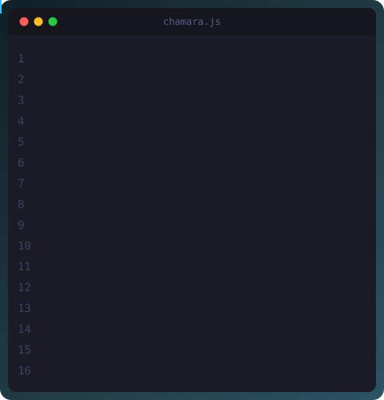
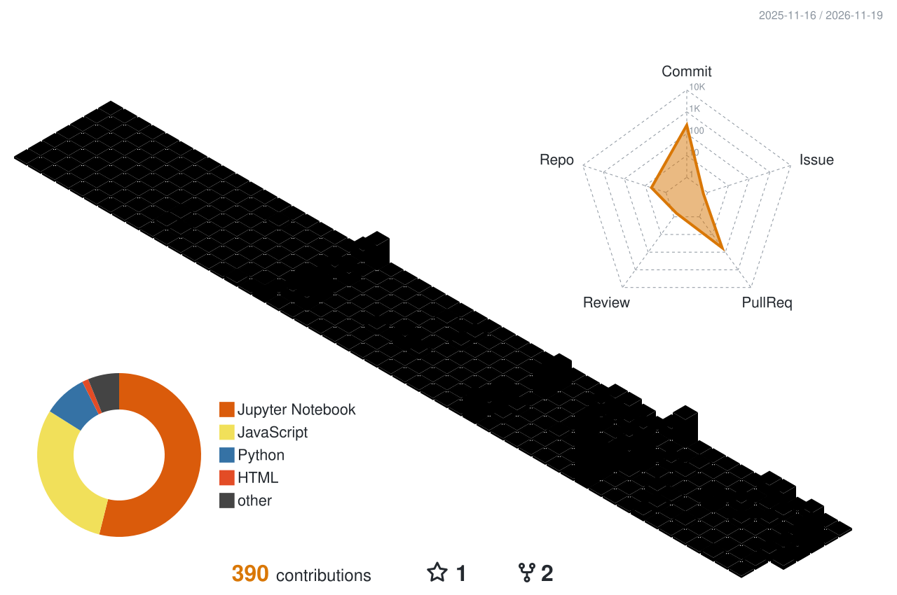

<!-- ======================= HEADER ======================= -->

  

  

  
  
  
  
  
  

 

<!-- ======================= ABOUT ======================= -->
<h2>About Me</h2>

<table>
  <tr>
    <td width="50%" valign="middle">
      
I'm an <b>Information Technology undergraduate at SLIIT</b> who enjoys turning ideas into working products, from the database schema all the way to a live cloud deployment.

      
For my final-year research, <b>CattleSense</b>, I built the mastitis-detection module and engineered the shared platform the whole team runs on.

      <table>
        <tr><td><b>Role</b></td><td>IT Undergraduate @ SLIIT</td></tr>
        <tr><td><b>Focus</b></td><td>Full-Stack Development, Machine Learning, Cloud (AWS)</td></tr>
        <tr><td><b>Currently</b></td><td>Extending CattleSense research for publication</td></tr>
        <tr><td><b>Learning</b></td><td>MLOps, System Design, Scalable Cloud Architecture</td></tr>
        <tr><td><b>Ask me about</b></td><td>Web apps, Android, Computer Vision, Databases</td></tr>
      </table>
    </td>
    <td width="50%" align="center" valign="middle">
      
    </td>
  </tr>
</table>

 

<!-- ======================= FEATURED ======================= -->
<h2>Featured Project</h2>

<table>
  <tr>
    <td>
      <h3>CattleSense &nbsp;|&nbsp; ML-Based Early Detection of Cattle Diseases</h3>
      

        
        
        
        
        
      

      
An integrated platform that helps farmers detect cattle diseases early using machine learning, with four disease-detection modules running behind one unified system.

      <ul>
        <li><b>My module:</b> Mastitis detection, covering model development, API and UI integration</li>
        <li><b>Platform engineering:</b> API gateway, frontend shell, central database and deployment for all four modules</li>
        <li><b>Deployment:</b> Hosted on AWS EC2 with all modules running end-to-end</li>
        <li><b>Validation:</b> Demonstrated to a veterinary doctor and farmers; supported by a letter from the Department of Animal Production and Health</li>
      </ul>
    </td>
  </tr>
</table>

 

<!-- ======================= TECH STACK ======================= -->
<h2>Tech Stack</h2>

<b>Languages</b>

  

<b>Web &amp; Mobile</b>

  

<b>Databases, Cloud &amp; Tools</b>

  

  

<b>ML, Vision &amp; Design</b>

  

 

<!-- ======================= STATS ======================= -->
<h2>GitHub Analytics</h2>

  

 

  <picture>
    <source media="(prefers-color-scheme: dark)" srcset="https://streak-stats.demolab.com?user=chamara2002&theme=tokyonight&hide_border=true&background=00000000"/>
    
  </picture>

 

  <picture>
    <source media="(prefers-color-scheme: dark)" srcset="https://raw.githubusercontent.com/chamara2002/chamara2002/output/github-snake-dark.svg"/>
    
  </picture>

<!-- ======================= FOOTER ======================= -->

  

