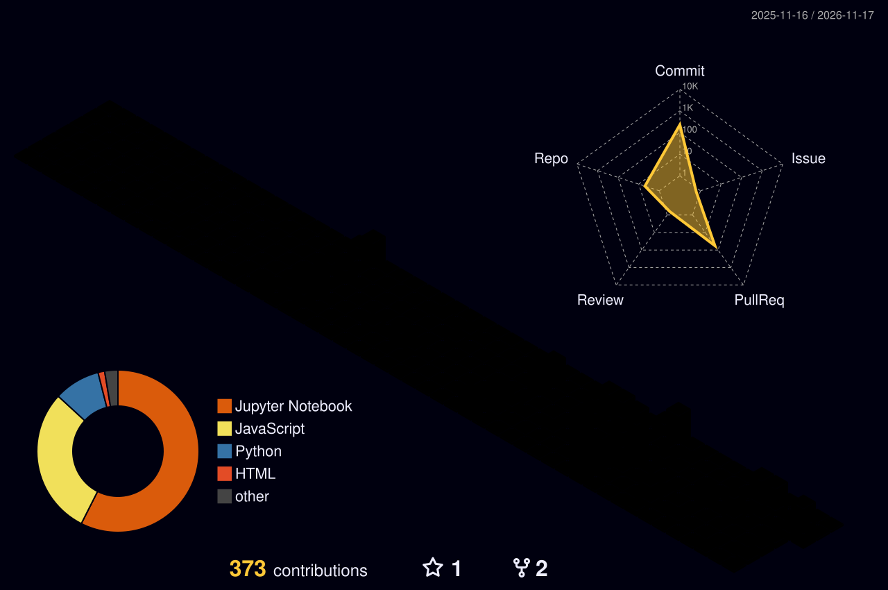

<!-- ═══════════════════════════ HEADER ═══════════════════════════ --> 
  
 
  
 
       

<!-- ═══════════════════════════ ABOUT ═══════════════════════════ -->
About Me
<table> <tr> <td width="58%" valign="top">

I'm an Information Technology undergraduate at SLIIT who enjoys turning ideas into working products — from the database schema all the way to a live cloud deployment.

My final-year research, CattleSense, is a machine-learning platform for the early detection of cattle diseases. Alongside building the mastitis-detection module, I designed and built the shared platform the whole team runs on: the API gateway, frontend shell, database and cloud deployment.

js
const chamara = {
  role:       "IT Undergraduate @ SLIIT",
  focus:      ["Full-Stack Development", "Machine Learning", "Cloud (AWS)"],
  currently:  "Polishing CattleSense research for publication",
  learning:   ["MLOps", "System Design", "Scalable Cloud Architecture"],
  askMeAbout: ["Web apps", "Android", "Computer Vision", "Databases"],
  reachMe:    "lccperera2002@gmail.com",
};
</td> <td width="42%" align="center" valign="middle">  </td> </tr> </table>
<!-- ═══════════════════════════ FEATURED ═══════════════════════════ -->
Featured Project
<table> <tr> <td>
CattleSense — ML-Based Early Detection of Cattle Diseases

SLIIT Final-Year Research Project

An integrated platform that helps farmers spot cattle diseases early using machine learning. Four disease-detection modules run behind one unified system.

My module: Mastitis detection — model development, API and UI integration
Platform engineering: API gateway, frontend shell, central database and cloud deployment for all four modules
Deployment: Hosted on AWS EC2, all modules live end-to-end
Validation: Demoed to a veterinary doctor and farmers; backed by a support letter from the Department of Animal Production and Health
</td> </tr> </table>
<!-- ═══════════════════════════ TECH STACK ═══════════════════════════ -->
Tech Stack

<b>Languages</b>
 
  
 
<b>Web & Mobile</b>
 
  
 
<b>Databases, Cloud & Tools</b>
 
     
 
<b>ML, Vision & Design</b>
 
  

<!-- ═══════════════════════════ STATS ═══════════════════════════ -->
GitHub Analytics
<!-- Generated daily by .github/workflows/snake.yml --> 
  
 
  
 
 <picture> <source media="(prefers-color-scheme: dark)" srcset="https://raw.githubusercontent.com/chamara2002/chamara2002/output/github-snake-dark.svg" />  </picture> 

<!-- ═══════════════════════════ FOOTER ═══════════════════════════ --> 
  

